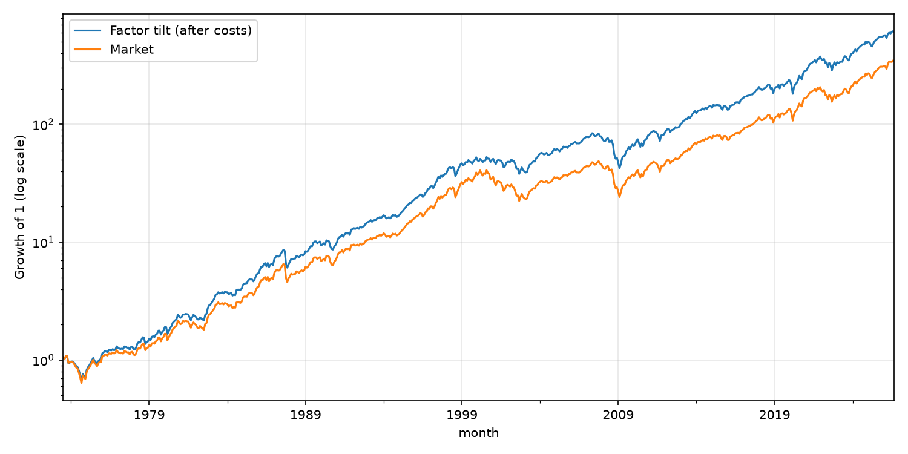

# Quant Research Framework

Factor-investing research on the Fama-French five-factor data: build factor-tilt portfolios month by month using only information available at the time, compare them with the market after costs, and explain any return with a five-factor regression.

This is the approach I used to tilt client portfolios towards factors at St. James International, rebuilt on public data so anyone can rerun it.

## What it does

| Piece | Detail |
|---|---|
| Data | Monthly Fama-French five factors (market, size, value, profitability, investment) and the T-bill rate from Kenneth French's data library, downloaded on first run and cached |
| Portfolios | Market plus long-short factor tilts; total tilt set by `--total-tilt` |
| Weighting | `equal`: the same tilt to each factor. `mv`: long-only maximum-Sharpe mix of the factors over a trailing window, shrunk towards equal tilts |
| No look-ahead | The weights for month *t* use factor returns up to month *t−1* only; a test checks it |
| Costs | A cost per unit of turnover and a yearly carry cost per unit of gross tilt, both configurable |
| Output | Annual return, volatility, Sharpe ratio, maximum drawdown, tracking error, information ratio, turnover; a five-factor regression with Newey-West t-statistics; an optional growth chart |

## Quick start

```bash
pip install -r requirements.txt
python main.py                                       # walk-forward max-Sharpe tilts, compared with equal tilts
python main.py --method equal                        # fixed equal tilts only
python main.py --total-tilt 0.6 --chart outputs/tilt.png
python main.py --start 2000-01 --trade-cost 0.002 --carry-cost 0.01
```

## Reading the output

* **Information ratio** is the tilt's average return above the market divided by how much it strays from the market. It is the number that says whether the tilts were worth the tracking error.
* **The regression** should show loadings close to the tilts you chose and an alpha near minus the costs. A large positive alpha would mean something is wrong, because the strategy is built from the factors themselves.
* Factor premia vary a lot across decades. Compare `--start 1990-01` with `--start 2010-01` before drawing conclusions.

## Results

Ken French five-factor data, monthly. The first ten years are used only to choose weights, so results run from July 1973 to September 2026. Both portfolios hold the market plus long-short factor positions with a total tilt of 0.5. Costs are 0.1% per unit of tilt turnover and 0.5% a year per unit of tilt held.

| | Walk-forward tilts | Equal tilts | Market |
|---|---|---|---|
| Annual return | 12.8% | 13.0% | 11.6% |
| Annual volatility | 15.5% | 15.5% | 15.8% |
| Sharpe ratio | 0.58 | 0.59 | 0.50 |
| Maximum drawdown | -49.7% | -50.4% | -50.3% |
| Tracking error | 2.6% | 2.6% | |
| Information ratio | 0.39 | 0.47 | |

Five-factor regression of the walk-forward portfolio (Newey-West t-statistics, 639 months): alpha of -0.54% a year (t = -3.2); loadings of 1.00 on the market, 0.10 on size, 0.08 on value, 0.20 on profitability and 0.13 on investment.

Holding the factors added about 1.2 to 1.4 points a year over the market with the same volatility and drawdown. Choosing the tilts each month from the past ten years did not help: it trailed simple equal tilts, and its negative alpha says the month-to-month changes cost money after costs. The factor returns come from paper portfolios, so the cost assumptions matter; higher costs would shrink the gap over the market.



## Tests

```bash
pytest -q
```

The tests check the Ken French file parser, that a zero tilt without costs equals the market, that changing future factor returns leaves earlier weights untouched, that tilts are long-only and sum to the chosen total, and that the regression recovers known loadings from simulated data.

## Project structure

```
├── main.py
├── src/
│   ├── data.py         # download and parse the Ken French five-factor file
│   ├── strategy.py     # walk-forward tilt weights, costs, performance table
│   └── regression.py   # factor regression with Newey-West standard errors
└── tests/test_framework.py
```

## References

Fama, E. F. and French, K. R. (2015). A five-factor asset pricing model. *Journal of Financial Economics*, 116(1), 1–22.

## Disclaimer

For research and education only. Not investment advice.

## License

MIT
